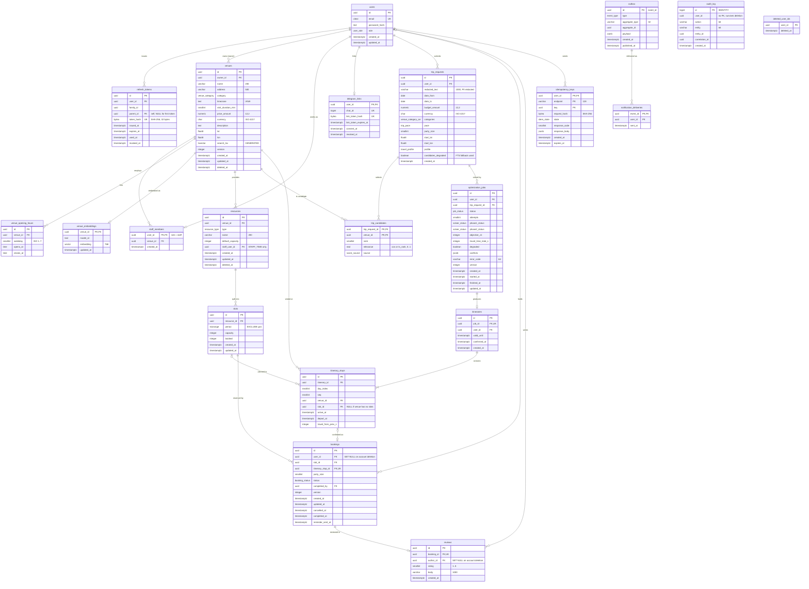
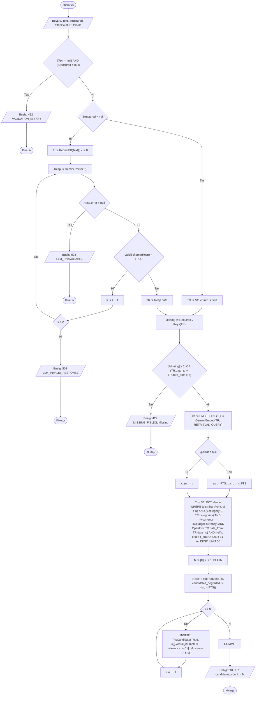
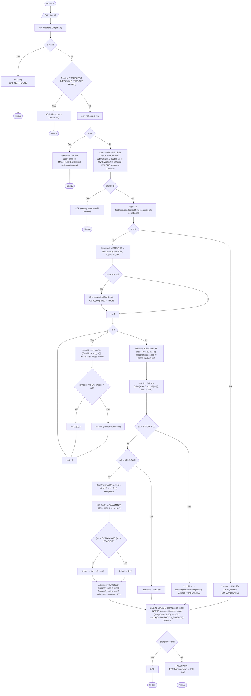
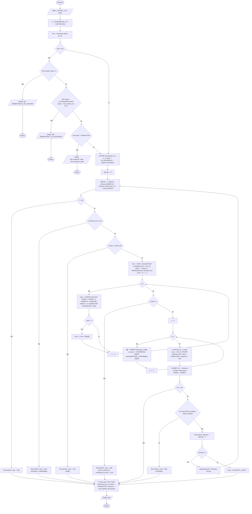

# РОЗДІЛ 2. ПРОЄКТУВАННЯ АРХІТЕКТУРИ
## 2.4. Проєктування та моделювання баз даних

Шар збереження даних реалізовано в одному інстансі PostgreSQL 17 (контейнер PostgreSQL, C4 рівень 2) з розширеннями `pgvector` ≥ 0.8 (HNSW), `cube`, `earthdistance`, `btree_gist`, `pg_trgm`, `citext`. Кожна таблиця має один сервіс-власник (принцип «один власник даних», 2.1.2); зовнішні ключі між доменами діють на рівні СУБД, доступ сервісу до таблиць іншого домену виконується лише через API власника. Redis не зберігає доменних даних: брокер містить лише `job_id` / `event_id`, кеш — матриці часу переміщення і лічильники rate limiting (DC-04).

> Трасування: вимоги — [srs.md](./srs.md) (FUN, NFR, Додатки A–C); архітектурні рішення — [adr/](./adr/); контейнери — підрозділ 2.1 цього файлу.

### 2.4.1. Логіко-фізична схема (ERD, Mermaid.js)

### 2.4.2. Загальні правила моделювання

| Правило | Рішення | Обґрунтування |
| --- | --- | --- |
| Первинні ключі | `uuid` (UUID v7, генерується застосунком) | Невгадувані ідентифікатори в API (BOLA, FUN-04); часова впорядкованість v7 зменшує фрагментацію B-Tree порівняно з v4 |
| Час | `timestamptz` (UTC); `date` лише для календарних меж поїздки; `time` + IANA `timezone` для графіків роботи | SRS-FUN-22, FUN-27; виключає помилки переходу на літній час |
| Гроші | `numeric(12,2)` + `char(3)` ISO 4217 | Точна десяткова арифметика; `float` для грошей заборонено |
| Переліки | Типи `ENUM` PostgreSQL (перелік значень — 2.4.4) | Збіг із `enum` в OpenAPI (2.5) і Додатком C SRS |
| Обмежені рядки | `varchar(n)` з довжиною зі SRS; `text` лише для неструктурованих описів | FUN-05 (1000), FUN-20 (1000) |
| Soft delete | `deleted_at` лише для `venues`, `resources` | Збереження історії бронювань; `users` видаляються фізично за Додатком B SRS (PRIV-04) |
| Оптимістичне блокування | `version integer` у `venues`, `optimization_jobs`, `bookings` | `UPDATE … WHERE version = :v` виключає втрачене оновлення |
| Аудит | `created_at`, `updated_at` (тригер); `audit_log` для змін ролей, ресурсів, слотів, статусів | SEC-10 |

### 2.4.3. Специфікація таблиць

**Домен Auth Service**

`users` — облікові записи.

| Поле | Тип | Обмеження | Опис |
| --- | --- | --- | --- |
| id | uuid | PK | Ідентифікатор користувача |
| email | citext | NOT NULL, UNIQUE | Регістронезалежний email |
| password_hash | text | NOT NULL | Argon2id (SEC-02), формат PHC |
| role | user_role | NOT NULL | `traveler`, `owner`, `staff`; `staff` не призначається самореєстрацією (FUN-01) |
| created_at, updated_at | timestamptz | NOT NULL DEFAULT now() | Технічні поля |

`staff_members` — прив'язка персоналу до закладу (FUN-19, FUN-23).

| Поле | Тип | Обмеження | Опис |
| --- | --- | --- | --- |
| user_id | uuid | PK, FK → users ON DELETE CASCADE | Користувач із роллю `staff` (перевіряється тригером) |
| venue_id | uuid | NOT NULL, FK → venues ON DELETE RESTRICT | Заклад; джерело істини для перевірки FUN-19 (не claims токена) |
| created_at | timestamptz | NOT NULL | — |

`refresh_tokens` — одноразові refresh-токени з виявленням повторного використання (FUN-24, SEC-01).

| Поле | Тип | Обмеження | Опис |
| --- | --- | --- | --- |
| id | uuid | PK | — |
| user_id | uuid | NOT NULL, FK → users ON DELETE CASCADE | Власник |
| family_id | uuid | NOT NULL | Родина ротації; відкликається повністю при повторному використанні |
| parent_id | uuid | FK → refresh_tokens, NULL | Попередній токен ланцюжка |
| token_hash | bytea | NOT NULL, UNIQUE, CHECK length = 32 | SHA-256; відкритий токен не зберігається |
| issued_at, expires_at | timestamptz | NOT NULL; expires_at ≤ issued_at + 7 діб | Абсолютний строк |
| used_at, revoked_at | timestamptz | NULL | Факт використання / відкликання |

`telegram_links` — згода і прив'язка Telegram (FUN-41, FUN-43).

| Поле | Тип | Обмеження | Опис |
| --- | --- | --- | --- |
| user_id | uuid | PK, FK → users ON DELETE CASCADE | — |
| chat_id | bigint | UNIQUE, NULL | Видаляється (`NULL`) при відкликанні згоди |
| link_token_hash | bytea | UNIQUE, NULL | Хеш одноразового deep-link токена |
| link_token_expires_at | timestamptz | NULL | TTL токена прив'язки |
| consent_at, revoked_at | timestamptz | NULL | Явна згода / відкликання |

**Домен Booking Service**

`venues` — заклади (FUN-27, FUN-28).

| Поле | Тип | Обмеження | Опис |
| --- | --- | --- | --- |
| id | uuid | PK | — |
| owner_id | uuid | NOT NULL, FK → users ON DELETE RESTRICT | Орендар; фільтр базового репозиторію (DC-10) |
| name | varchar(200) | NOT NULL | — |
| address | varchar(500) | NOT NULL | Вхід для геокодування (FUN-13) |
| category | venue_category | NOT NULL | — |
| timezone | text | NOT NULL, CHECK ∈ pg_timezone_names | IANA |
| visit_duration_min | smallint | NOT NULL, CHECK 5…720 | Тривалість візиту (обмеження (б) FUN-33) |
| price_amount | numeric(12,2) | NOT NULL, CHECK ≥ 0 | Ціна за особу |
| currency | char(3) | NOT NULL, CHECK ~ '^[A-Z]{3}$' | ISO 4217 |
| description | text | NULL, CHECK length ≤ 5000 | Вхід для embeddings |
| lat, lon | float8 | NOT NULL, CHECK діапазону | Результат Mapbox Geocoding (`permanent=true`) |
| search_tsv | tsvector | GENERATED ALWAYS … STORED | `to_tsvector('simple', name ‖ description)` для деградації REL-04 |
| version | integer | NOT NULL DEFAULT 0 | Оптимістичне блокування |
| created_at, updated_at, deleted_at | timestamptz | deleted_at NULL | Soft delete |

`venue_opening_hours` — графік роботи; нічний інтервал зберігається двома рядками.

| Поле | Тип | Обмеження | Опис |
| --- | --- | --- | --- |
| id | uuid | PK | — |
| venue_id | uuid | NOT NULL, FK → venues ON DELETE CASCADE | — |
| weekday | smallint | NOT NULL, CHECK 1…7 | ISO 8601 |
| opens_at, closes_at | time | NOT NULL, CHECK opens_at < closes_at | Локальний час закладу |

`venue_embeddings` — вектори закладів (FUN-07, FUN-31). Винесено з `venues`: рядок `vector(768)` займає ≈ 3 КБ; окрема таблиця не збільшує обсяг читання каталогу (PERF-01) і дозволяє переіндексацію за `model_id`.

| Поле | Тип | Обмеження | Опис |
| --- | --- | --- | --- |
| venue_id | uuid | PK, FK → venues ON DELETE CASCADE | — |
| model_id | text | NOT NULL | Напр. `gemini-embedding-2` |
| embedding | vector(768) | NOT NULL | L2-нормалізований вектор |
| updated_at | timestamptz | NOT NULL | — |

`resources` — бронювальні ресурси (FUN-16).

| Поле | Тип | Обмеження | Опис |
| --- | --- | --- | --- |
| id | uuid | PK | — |
| venue_id | uuid | NOT NULL, FK → venues ON DELETE RESTRICT | — |
| type | resource_type | NOT NULL | — |
| name | varchar(200) | NOT NULL | — |
| default_capacity | integer | NOT NULL, CHECK ≥ 1 | Значення за замовчуванням для нових слотів (FUN-37) |
| staff_user_id | uuid | FK → users ON DELETE SET NULL, NULL | Лише для `STAFF_TIME` (CHECK) |
| created_at, updated_at, deleted_at | timestamptz | — | Soft delete дозволено лише без активних бронювань (409) |

`slots` — часові слоти ресурсу.

| Поле | Тип | Обмеження | Опис |
| --- | --- | --- | --- |
| id | uuid | PK | — |
| resource_id | uuid | NOT NULL, FK → resources ON DELETE RESTRICT | — |
| period | tstzrange | NOT NULL, `EXCLUDE USING gist (resource_id WITH =, period WITH &&)` | Неперекриття слотів (FUN-37, DC-07) |
| capacity | integer | NOT NULL, CHECK ≥ 1 | Місткість конкретного слота |
| booked | integer | NOT NULL DEFAULT 0, CHECK 0 ≤ booked ≤ capacity | Інваріант REL-01 на рівні СУБД |
| created_at, updated_at | timestamptz | — | — |

`bookings` — бронювання (FUN-17–FUN-19, FUN-39).

| Поле | Тип | Обмеження | Опис |
| --- | --- | --- | --- |
| id | uuid | PK | — |
| user_id | uuid | FK → users ON DELETE SET NULL | Анонімізація за Додатком B |
| slot_id | uuid | NOT NULL, FK → slots ON DELETE RESTRICT | Заклад визначається через slot → resource → venue |
| itinerary_stop_id | uuid | UNIQUE, FK → itinerary_stops ON DELETE SET NULL | Зв'язок із маршрутом |
| party_size | smallint | NOT NULL, CHECK 1…20 | Скільки місць займає бронювання |
| status | booking_status | NOT NULL | Переходи — Додаток C.2 |
| completed_by | uuid | FK → users ON DELETE SET NULL | Хто з `staff` підтвердив візит |
| version | integer | NOT NULL DEFAULT 0 | — |
| created_at, updated_at | timestamptz | NOT NULL | — |
| cancelled_at, completed_at | timestamptz | CHECK узгодженості зі `status` | — |
| reminder_sent_at | timestamptz | NULL | Стан нагадування для Celery beat (ADR, захід 4) |

`reviews` — відгуки (FUN-20).

| Поле | Тип | Обмеження | Опис |
| --- | --- | --- | --- |
| id | uuid | PK | — |
| booking_id | uuid | NOT NULL, UNIQUE, FK → bookings ON DELETE CASCADE | Один відгук на бронювання; статус `COMPLETED` перевіряє сервіс у транзакції |
| author_id | uuid | FK → users ON DELETE SET NULL | — |
| rating | smallint | NOT NULL, CHECK 1…5 | — |
| body | varchar(1000) | NOT NULL | — |
| created_at | timestamptz | NOT NULL | — |

**Домен Recommendation Service і Optimization Worker**

`trip_requests` — структурований намір (FUN-05).

| Поле | Тип | Обмеження | Опис |
| --- | --- | --- | --- |
| id | uuid | PK | — |
| user_id | uuid | NOT NULL, FK → users ON DELETE CASCADE | — |
| redacted_text | varchar(1000) | NULL | Текст після редакції PII (PRIV-01); NULL для структурованої форми |
| date_from, date_to | date | NOT NULL, CHECK date_to − date_from ∈ [0, 6] | 1–7 днів |
| budget_amount | numeric(12,2) | NOT NULL, CHECK > 0 | — |
| currency | char(3) | NOT NULL | Кандидати фільтруються за збігом валюти |
| categories | venue_category[] | NOT NULL DEFAULT '{}' | — |
| pace | trip_pace | NOT NULL DEFAULT 'NORMAL' | — |
| party_size | smallint | NOT NULL, CHECK 1…20 | — |
| start_lat, start_lon | float8 | NOT NULL | Не передаються до Gemini (FUN-05) |
| profile | travel_profile | NOT NULL DEFAULT 'WALKING' | Профіль Mapbox Matrix (FUN-14) |
| candidates_degraded | boolean | NOT NULL | Використано FTS замість embeddings |
| created_at | timestamptz | NOT NULL | — |

`trip_candidates` — знімок відібраних кандидатів (FUN-08); робить задачу відтворюваною: Optimization Worker не звертається до Gemini.

| Поле | Тип | Обмеження | Опис |
| --- | --- | --- | --- |
| trip_request_id | uuid | PK, FK → trip_requests ON DELETE CASCADE | — |
| venue_id | uuid | PK, FK → venues ON DELETE RESTRICT | — |
| rank | smallint | NOT NULL, CHECK 1…50 | Позиція за спаданням релевантності |
| relevance | real | NOT NULL, CHECK 0…1 | `cos_i` або нормалізований `ts_rank` |
| source | score_source | NOT NULL | `EMBEDDING` або `FTS` |

`optimization_jobs` — джерело істини статусу задачі (FUN-11).

| Поле | Тип | Обмеження | Опис |
| --- | --- | --- | --- |
| id | uuid | PK | `job_id` у повідомленні брокера |
| user_id | uuid | NOT NULL, FK → users ON DELETE CASCADE | — |
| trip_request_id | uuid | NOT NULL, FK → trip_requests ON DELETE CASCADE | — |
| status | job_status | NOT NULL DEFAULT 'PENDING' | Додаток C.1 |
| attempts | smallint | NOT NULL DEFAULT 0, CHECK 0…4 | Лічильник доставок (REL-06) |
| phase1_status, phase2_status | solver_status | NULL | `OPTIMAL` / `FEASIBLE` |
| objective_z1 | integer | NULL | Z1* фази 1 |
| travel_time_total_s | integer | NULL, CHECK ≥ 0 | Ціль фази 2 |
| degraded | boolean | NOT NULL DEFAULT false | Haversine або FTS |
| conflicts | jsonb | NULL, CHECK jsonb_typeof = 'array' | `[{constraint_id, type, entities}]` (FUN-12) |
| error_code | varchar(64) | NULL | Для `FAILED`, `TIMEOUT` |
| version | integer | NOT NULL DEFAULT 0 | CAS при переході `PENDING → RUNNING` |
| created_at, started_at, finished_at, updated_at | timestamptz | — | Метрики тривалості |

`itineraries`, `itinerary_stops` — результат розв'язання.

| Таблиця.Поле | Тип | Обмеження | Опис |
| --- | --- | --- | --- |
| itineraries.id | uuid | PK | — |
| itineraries.job_id | uuid | NOT NULL, UNIQUE, FK → optimization_jobs ON DELETE CASCADE | Створюється лише для `SUCCESS` |
| itineraries.user_id | uuid | NOT NULL, FK → users ON DELETE CASCADE | Перевірка власника (FUN-38) |
| itineraries.valid_until | timestamptz | NOT NULL | TTL розкладу (FUN-36, TBD-05) |
| itineraries.confirmed_at | timestamptz | NULL | Повторне підтвердження → 409 |
| itinerary_stops.itinerary_id | uuid | NOT NULL, FK ON DELETE CASCADE; UNIQUE (itinerary_id, day_index, seq) | — |
| itinerary_stops.day_index | smallint | CHECK 0…6 | День поїздки |
| itinerary_stops.seq | smallint | CHECK ≥ 0 | Порядок відвідування |
| itinerary_stops.venue_id | uuid | NOT NULL, FK → venues | — |
| itinerary_stops.slot_id | uuid | FK → slots, NULL | NULL для закладу без слотів |
| itinerary_stops.arrive_at, depart_at | timestamptz | CHECK arrive_at < depart_at | — |
| itinerary_stops.travel_from_prev_s | integer | CHECK ≥ 0 | — |

**Інфраструктурні таблиці**

| Таблиця | Ключові поля | Призначення |
| --- | --- | --- |
| `idempotency_keys` | PK (user_id, endpoint, key); request_hash bytea(32); state idem_state; response_code smallint; response_body jsonb; expires_at = created_at + 24 год | REL-01: повтор → збережений результат; інше тіло → 422; `IN_PROGRESS` → 409 |
| `outbox` | id uuid PK (`event_id`); type event_type; aggregate_type varchar(32); aggregate_id uuid; payload jsonb (без PII); published_at NULL | Transactional Outbox (FUN-40, DC-08) |
| `notification_deliveries` | PK (event_id, user_id); sent_at | Дедуплікація доставки at-least-once (REL-07) |
| `audit_log` | id bigint IDENTITY; user_id uuid без FK; action, entity varchar(64); entity_id; correlation_id; created_at | SEC-10; без FK, щоб запис переживав видалення користувача |
| `deleted_user_ids` | user_id PK; deleted_at | PRIV-04: повторне застосування видалення після відновлення з копії |

### 2.4.4. Типи ENUM

| Тип | Значення |
| --- | --- |
| user_role | traveler, owner, staff |
| venue_category | HOTEL, RESTAURANT, CAFE, MUSEUM, SHOP, PARK, EVENT, TOUR |
| resource_type | ROOM, TABLE, TOUR_SEAT, STAFF_TIME |
| trip_pace | RELAXED, NORMAL, INTENSIVE |
| travel_profile | WALKING, DRIVING |
| score_source | EMBEDDING, FTS |
| job_status | PENDING, RUNNING, SUCCESS, INFEASIBLE, TIMEOUT, FAILED |
| solver_status | OPTIMAL, FEASIBLE |
| booking_status | CONFIRMED, COMPLETED, CANCELLED |
| idem_state | IN_PROGRESS, COMPLETED |
| event_type | BOOKING_CONFIRMED, BOOKING_CANCELLED, BOOKING_COMPLETED, OPTIMIZATION_FINISHED |

### 2.4.5. План індексування

| Таблиця | Індекс | Тип | Запит / вимога |
| --- | --- | --- | --- |
| venue_embeddings | `(embedding vector_cosine_ops)`, m = 16, ef_construction = 64; сесійно `hnsw.ef_search = 100`, `hnsw.iterative_scan = relaxed_order` | HNSW | ANN top-50 з фільтрами (FUN-08, PERF-02) |
| venues | `(ll_to_earth(lat, lon)) WHERE deleted_at IS NULL` | GiST (earthdistance) | Радіус від start_point (FUN-08, FUN-28) |
| venues | `(category) WHERE deleted_at IS NULL` | B-Tree | Фільтр каталогу |
| venues | `(owner_id)` | B-Tree | Фільтр орендаря DC-10 |
| venues | `(search_tsv)`; `(name gin_trgm_ops)` | GIN | Деградація REL-04 (`simple` + `pg_trgm`) |
| venue_opening_hours | `(venue_id, weekday)` | B-Tree | Фільтр «відкрито в інтервалі» |
| slots | `EXCLUDE (resource_id =, period &&)` | GiST (btree_gist) | Неперекриття; пошук слотів ресурсу |
| slots | `(lower(period))` | B-Tree | Вибірка нагадувань [T+59, T+60] хв (FUN-22) |
| bookings | `(user_id, created_at DESC, id)` | B-Tree | Keyset-пагінація `GET /v1/bookings` |
| bookings | `(slot_id) WHERE status = 'CONFIRMED' AND reminder_sent_at IS NULL` | B-Tree, partial | Celery beat нагадувань; перевірка активних бронювань перед видаленням слота |
| optimization_jobs | `(user_id) WHERE status IN ('PENDING','RUNNING')` | B-Tree, partial | Ліміт 2 активних задач (SEC-07) |
| optimization_jobs | `(updated_at) WHERE status IN ('PENDING','RUNNING')` | B-Tree, partial | Фоновий процес застарілих задач |
| refresh_tokens | `UNIQUE (token_hash)`; `(family_id)` | B-Tree | Оновлення пари; відкликання родини |
| outbox | `(created_at) WHERE published_at IS NULL` | B-Tree, partial | Вибірка Outbox Relay |
| idempotency_keys | `(expires_at)` | B-Tree | Очищення ключів старших за 24 год |
| audit_log | `(created_at)`; `(entity, entity_id)` | BRIN; B-Tree | Append-only журнал; пошук історії сутності |

## 2.5. Специфікація міжсервісних контрактів (API Contracts)

Обраний формат: OpenAPI 3.1 (YAML), що відповідає SRS-NFR-MNT-02 і є надмножиною OpenAPI 3.0. Контракт описує критичний бізнес-сценарій «запит → оптимізація → підтвердження маршруту → бронювання» на межі контейнерів React SPA → Reverse Proxy → API Gateway та сервісів-власників (C4 рівень 2, зв'язки C2а-05, C2а-06, C2а-09, C2а-10).

| Операція | Контейнер-власник | Вимоги SRS | Ключові коди |
| --- | --- | --- | --- |
| `POST /v1/trip-requests` | Recommendation Service | FUN-05, 06, 08, 30, 35; PRIV-01 | 201, 422, 429, 502, 503 |
| `POST /v1/trips` | Recommendation Service | FUN-09; PERF-03; SEC-07; REL-06 | 202 + `Location`, 404, 409, 422, 429, 503 |
| `GET /v1/jobs/{job_id}` | Recommendation Service | FUN-11, 12 | 200 + `Retry-After`, 404 |
| `GET /v1/itineraries/{itinerary_id}` | Booking Service | FUN-15 | 200, 404 |
| `PUT /v1/itineraries/{itinerary_id}/confirmation` | Booking Service | FUN-17, 36, 38; REL-01 | 201 / 200, 409, 410, 422 |
| `GET /v1/bookings` | Booking Service | FUN-42 | 200 (keyset-пагінація) |
| `PUT /v1/bookings/{booking_id}/cancellation` | Booking Service | FUN-18, 39 | 200, 409 |
| `PUT /v1/bookings/{booking_id}/completion` | Booking Service | FUN-19, 39 | 200, 403, 409 |

Схема безпеки: `accessCookie` — JWT ES256 у cookie `__Host-access` (SEC-01, SEC-04); `csrfHeader` — `X-CSRF-Token` для змінювальних методів. Помилки — RFC 9457 `application/problem+json` з машинним полем `code`. Усі схеми вводу мають `additionalProperties: false` (еквівалент `extra="forbid"`, SEC-06). Контракт Auth Service (`/v1/auth/*`) зафіксовано окремим файлом у Розділі 3.

Деталізовану специфікацію ендпоінтів у форматі OpenAPI 3.1 зафіксовано у файлі [openapi.yaml](./api/openapi.yaml).

## 2.6. Моделювання логіки критичних вузлів системи

Позначення: `:=` — присвоювання; `=` — порівняння; `AND`, `OR`, `NOT` — булеві оператори; `X[i]` — i-й елемент масиву; `|X|` — потужність множини; `∅` — порожня множина. Блоки: овал — термінатор, паралелограм — ввід/вивід, прямокутник — процес, ромб — рішення.

### 2.6.1. Алгоритм 1. Інтерпретація наміру і відбір кандидатів (Recommendation Service, `POST /v1/trip-requests`)

Вхід: користувач `u`, текст `Text` або структурована форма `Structured`, точка старту, радіус `R`, профіль. Вихід: `TripRequest` і знімок кандидатів `C[1..N]`, N ≤ 50.

1. Якщо `(Text = null) AND (Structured = null)` → 422.
2. Якщо `Structured ≠ null`: `TR := Structured`, виклик LLM пропускається.
3. Інакше `T' := RedactPII(Text)`; `k := 0`; цикл: `Resp := Gemini.Parse(T')`; якщо `Resp.error ≠ null` (після політики REL-02) → 503 `LLM_UNAVAILABLE`; якщо `ValidSchema(Resp) = FALSE` → `k := k + 1`, при `k ≤ 2` повтор, інакше 502 `LLM_INVALID_RESPONSE`. Цикл обмежено 3 викликами.
4. `Missing := Required \ Keys(TR)`; якщо `(|Missing| ≥ 1) OR (TR.date_to − TR.date_from ≥ 7)` → 422.
5. `src := EMBEDDING`; `Q := Gemini.Embed(TR)`; якщо `Q.error ≠ null` → `src := FTS`, `τ_src := τ_FTS`, інакше `τ_src := τ`.
6. `C := SELECT … WHERE (dist ≤ R) AND (category ∈ TR.categories) AND (currency = TR.currency) AND OpenIn(...) AND (rel ≥ τ_src) ORDER BY rel DESC LIMIT 50`; `N := |C|`.
7. В одній транзакції: `INSERT TripRequest`; для `i := 1..N` — `INSERT TripCandidate(rank := i, relevance := C[i].rel, source := src)`.
8. Вивід 201, `candidates_count := N` (N = 0 допустимо; задачу для такого запиту відхиляє `POST /v1/trips` з кодом 422 `NO_CANDIDATES`).

### 2.6.2. Алгоритм 2. Двофазне розв'язання TOPTW (Optimization Worker, Optimize Schedule Use Case)

Вхід: `job_id` з черги `optimization`. Вихід: стан задачі `SUCCESS | INFEASIBLE | TIMEOUT | FAILED`, маршрут і подія `OPTIMIZATION_FINISHED` в одній транзакції.

1. `J := JobStore.Get(job_id)`; якщо `J = null` → ACK. Якщо `J.status` термінальний → ACK (Idempotent Consumer, REL-03).
2. `a := J.attempts + 1`; якщо `a ≥ 4` → `FAILED`, `error_code := MAX_RETRIES`, публікація в `optimization.dead` (REL-06).
3. CAS-перехід у `RUNNING` за `version`; якщо `rows = 0` → ACK (задачу взяв інший worker).
4. `Cand := Candidates(J)`, `n := |Cand|`; якщо `n = 0` → `FAILED`, `NO_CANDIDATES`.
5. `M := Geo.Matrix(...)`; якщо помилка → `M := Haversine(...)`, `degraded := TRUE` (REL-04).
6. Для `i := 1..n`: `score[i] := round(S · (Cand[i].rel − τ_src))`; `Arcs[i] := {j : M[i][j] ≠ null}`; якщо `(|Arcs[i]| = 0) OR (M[0][i] = null)` → `x[i] := 0` (FUN-34).
7. Фаза 1: `(st1, Z1, Sol1) := Solve(MAX Σ score[i] · x[i], 20 с)`, `num_workers := 1`, фіксований `seed`. `st1 = INFEASIBLE` → `conflicts := Explain(assumptions)`; `st1 = UNKNOWN` → `TIMEOUT`.
8. Фаза 2: обмеження `Σ score[i] · x[i] ≥ ⌈(1 − ε) · Z1⌉`, підказка `Sol1`; `(st2, Sol2) := Solve(MIN Σ t[i][j] · y[i][j], 10 с)`. Якщо `NOT ((st2 = OPTIMAL) OR (st2 = FEASIBLE))` → `Sched := Sol1`, `st2 := st1`.
9. Транзакція: оновлення `optimization_jobs`, вставка `itineraries` / `itinerary_stops` (лише `SUCCESS`), `outbox`. Виняток → ROLLBACK і повтор із затримкою `2^(a − 1)` с.

Сумарний ліміт розв'язувача 30 с < `soft_time_limit` 35 с < `time_limit` 40 с < `visibility_timeout` 160 с (DC-05, ADR).

### 2.6.3. Алгоритм 3. Атомарне підтвердження маршруту (Booking Service, `PUT /v1/itineraries/{id}/confirmation`)

Вхід: `u`, `itinerary_id`, ключ `K`, тіло. Вихід: 201 з бронюваннями або код відмови; стан лічильників змінюється лише при 201.

1. `h := SHA256(Body)`; `Rec := IdemKeys.Get(u, ep, K)`. Якщо `Rec.request_hash ≠ h` → 422; якщо `(Rec.state = IN_PROGRESS) AND (вік ≤ 60 с)` → 409; якщо `Rec.state = COMPLETED` → збережена відповідь. Запис `IN_PROGRESS` фіксується окремою транзакцією, щоб ROLLBACK основної транзакції його не скасовував.
2. `attempt := 0`. `BEGIN`; `I := SELECT … FOR UPDATE` з умовою `user_id = u` (BOLA → 404). Якщо `I.confirmed_at ≠ null` → 409; якщо `now() ≥ I.valid_until` → 410.
3. `Slot := SORT_ASC(DISTINCT slot_id)`, `n := |Slot|`, `p := TripRequest(I.job_id).party_size`, `Conf := ∅`. Для `i := 1..n`: `rows := UPDATE slots SET booked := booked + p WHERE id = Slot[i] AND booked + p ≤ capacity AND lower(period) ≥ now()`; якщо `rows = 0` → `Conf := Conf ∪ {Slot[i]}`. Порядок зростання `slot_id` виключає взаємне блокування (DC-07).
4. Якщо `|Conf| ≥ 1` → ROLLBACK, 409 `SLOT_CONFLICT` з `conflicting_slot_ids := Conf`.
5. Для `j := 1..n`: `INSERT booking(status := CONFIRMED)`, `INSERT outbox(BOOKING_CONFIRMED)`. `I.confirmed_at := now()`; ключ ідемпотентності → `COMPLETED`; `COMMIT`.
6. Якщо `Err.SQLSTATE ∈ {40001, 40P01, 55P03}` → ROLLBACK, `attempt := attempt + 1`; при `attempt ≤ 3` — затримка з повним jitter і повтор з кроку 2, інакше 503. Інша помилка → 500.

### 2.6.4. Обробка граничних випадків

| Випадок | Алгоритм | Поведінка |
| --- | --- | --- |
| Порожній запит, неповні поля | 1 | 422 з переліком `missing_fields` |
| LLM недоступний / невалідна відповідь | 1 | 503 (клієнт переходить на структуровану форму) / 502 після 3 викликів |
| Embeddings недоступні | 1 | FTS з окремим порогом `τ_FTS`, `candidates_degraded = true` |
| 0 кандидатів | 1, 2 | `POST /v1/trips` → 422; у worker-і захисна гілка `FAILED NO_CANDIDATES` |
| Повторна доставка задачі після SIGKILL | 2 | Термінальний статус → ACK; CAS за `version` виключає подвійне виконання |
| Вичерпання повторів | 2 | `a ≥ 4` → `FAILED`, dead-letter |
| Mapbox недоступний або `null` у матриці | 2 | Haversine + `degraded`; дуги `null` і недосяжні точки виключаються |
| Фаза 1 без розв'язку в межах ліміту | 2 | `TIMEOUT` (стан CP-SAT `UNKNOWN`) |
| Фаза 2 не знайшла розв'язку | 2 | Повертається розв'язок фази 1 |
| Конкурентне бронювання одного слота | 3 | Атомарний UPDATE з умовою місткості; рівно `C` успіхів (REL-01) |
| Deadlock / serialization failure / lock timeout | 3 | ≤ 3 повтори з jitter, далі 503 |
| Прострочений розклад | 3 | 410 |
| Маршрут без слотів (`n = 0`) | 3 | Підтвердження без бронювань, 201 з порожнім `bookings` |

## 2.7. Інтеграційний аудит та верифікація цілісності доменів

### 2.7.1. Метод

Перехресно звірено три артефакти: схему даних (2.4), контракт `openapi.yaml` (2.5) і алгоритми 1–3 (2.6), а також їх відповідність SRS v0.2, C4 (2.1–2.2) і ADR брокера. Інструментальні перевірки:

| Перевірка | Інструмент | Результат |
| --- | --- | --- |
| Синтаксис і рендеринг 4 діаграм Mermaid | `@mermaid-js/mermaid-cli` (`mmdc`) | 4 / 4 відрендерено без помилок |
| Парсинг YAML, розв'язання всіх `$ref` | PyYAML + власний скрипт | 0 розірваних посилань |
| Валідність усіх схем `components.schemas` як JSON Schema 2020-12 | `jsonschema` (Draft202012Validator) | 0 помилок |
| Унікальність `operationId`, відповідність path-параметрів шаблону шляху, наявність 401 / 429 у кожній операції, CSRF у змінювальних методах | власний скрипт | 8 операцій, 0 порушень |

Повна валідація за метасхемою OpenAPI 3.1 (Spectral або `openapi-spec-validator`) додається в CI (MNT-02) і виконується в Розділі 3.

### 2.7.2. Виявлені розбіжності та їх усунення

| ID | Тип | Розбіжність | Виправлення | Змінені артефакти |
| --- | --- | --- | --- | --- |
| IM-01 | API ↔ NFR | За SRS Додаток A `POST /v1/trips` одночасно викликає Gemini (FUN-05) і повинен відповідати 202 за p95 ≤ 100 мс (PERF-03); виклик LLM робить поріг недосяжним | Операцію розділено: `POST /v1/trip-requests` (синхронно: LLM, ANN, знімок кандидатів) і `POST /v1/trips` (лише запис задачі і публікація) | openapi.yaml, ERD (`trip_candidates`), SRS Додаток A |
| IM-02 | API ↔ Data | Шлях `/v1/routes/{id}/confirm` у SRS не відповідає сутності `itineraries`; дієслово в шляху порушує REST-іменування | `PUT /v1/itineraries/{id}/confirmation`; аналогічно `/bookings/{id}/cancellation`, `/completion` | openapi.yaml, SRS Додаток A |
| IM-03 | Logic ↔ Data | Алгоритм 3 використовував `I.party_size`, але в `itineraries` такого поля немає | `p := TripRequest(I.job_id).party_size`; дублювання поля в `itineraries` відхилено (порушення 3NF) | Алгоритм 3 |
| IM-04 | Data (цикл FK) | `users.venue_id → venues` і `venues.owner_id → users` утворювали циклічну залежність | Прив'язку персоналу винесено в `staff_members(user_id PK, venue_id)` | ERD, специфікація таблиць |
| IM-05 | Logic ↔ API | Алгоритм 2 повертав `INFEASIBLE` з конфліктом `NO_CANDIDATES`, якого немає в `ConstraintType` API | 0 кандидатів відсікається в `POST /v1/trips` (422 `NO_CANDIDATES`); у worker-і — `FAILED` з `error_code` | Алгоритм 2, openapi.yaml |
| IM-06 | Logic ↔ Data | Обмеження бюджету (г) FUN-33 сумує ціни різних валют | Кандидати фільтруються за `venues.currency = trip_requests.currency`; конвертацію валют виключено з меж | Алгоритм 1, ERD |
| IM-07 | Logic ↔ SRS | Поріг `τ` визначено для `cos_i`; при деградації на FTS (FUN-35) розподіл `ts_rank` інший | Введено окремий поріг `τ_FTS` і поле `trip_candidates.source` | Алгоритм 1, 2; ERD; TBD-15 |
| IM-08 | API ↔ Data | `Booking.venue_id` у відповіді API не має відповідного стовпця в `bookings` | Поле обчислюється з'єднанням slot → resource → venue; денормалізацію не додано | Специфікація 2.4.3 |
| IM-09 | Logic ↔ Data | Лічильник спроб у алгоритмі 2 не зберігався в БД, тож перевірка `attempts ≥ 4` не переживала перезапуск worker-а | `attempts := a` записується в тому самому CAS-оновленні, що й `RUNNING` | Алгоритм 2 |
| IM-10 | Logic (транзакції) | Збереження відповіді ідемпотентності для відмов (409, 410) у тій самій транзакції скасовувалося ROLLBACK | Запис `IN_PROGRESS` і фіксація відмови виконуються окремими транзакціями | Алгоритм 3 |

### 2.7.3. Production Readiness Report

| Критерій | Стан |
| --- | --- |
| Кожне поле запитів і відповідей API має джерело в схемі даних (стовпець або детерміноване з'єднання) | Виконано |
| Типи узгоджені: UUID ↔ `uuid`, `date-time` ↔ `timestamptz`, `date` ↔ `date`, Money (десятковий рядок за `pattern` схеми `Money`) ↔ `numeric(12,2)`, enum API ↔ ENUM PostgreSQL | Виконано |
| Статуси задач і бронювань однакові в Додатку C SRS, ENUM схеми, OpenAPI і алгоритмах | Виконано |
| Кожна змінна алгоритмів 1–3 (`rel`, `source`, `attempts`, `version`, `valid_until`, `confirmed_at`, `booked`, `capacity`, `party_size`) зафіксована в схемі | Виконано |
| Цикли алгоритмів обмежені (≤ 3 виклики LLM, ≤ 3 повтори транзакції, ≤ 4 доставки задачі, ліміт CP-SAT 30 с) | Виконано |
| Критичні блокери (showstoppers) | Відсутні |

Висновок: специфікації шару даних, API-контрактів і логіки критичних вузлів узгоджені між собою та з SRS v0.2 і придатні до передачі в реалізацію (Розділ 3) за умови внесення до SRS змін, наведених нижче.

Зміни, які потрібно перенести в SRS (v0.3):

- Додаток A: `POST /v1/trip-requests`; `PUT /v1/itineraries/{id}/confirmation`; `PUT /v1/bookings/{id}/cancellation`, `/completion`; `GET /v1/itineraries/{id}`.
- TBD-15: значення `τ_FTS` для деградованого відбору.
- FUN-08: явна умова збігу валюти закладу і бюджету.

Залишкові ризики (не блокери): час побудови моделі CP-SAT для екземпляра (б) 50 кандидатів не виміряно і разом із 30 с розв'язання може наблизитися до `soft_time_limit` 35 с (перевірка — PERF-04 harness); поведінка `hnsw.iterative_scan` при селективних фільтрах підлягає бенчмарку (TBD-12).
